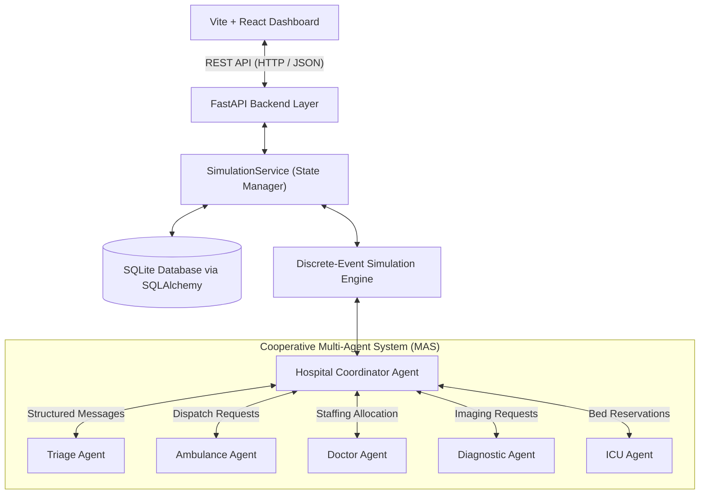
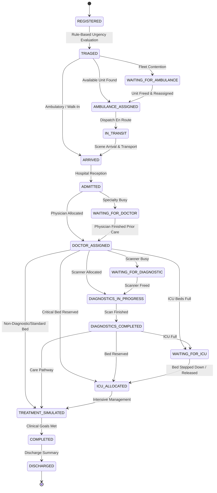

# System Architecture Specification
## Priority-Aware Multi-Agent Hospital Emergency Coordination and Resource Scheduling Simulator

### 1. High-Level System Architecture

The application is engineered as a cooperative, decentralized **Multi-Agent System (MAS)** where five specialized resource agents collaborate under a centralized **Hospital Coordinator** to optimize emergency patient throughput and manage scarce clinical resources.

---

### 2. Multi-Agent Communication Protocol

The coordinator calls specialist agents synchronously and records typed structured messages for each handoff:
- **Message Fields:** `message_id`, `sender`, `receiver`, `message_type`, `patient_id`, `resource_id`, `simulation_time`, `correlation_id`, `payload`, `status`.
- **Communication Pattern:** Coordinator-mediated direct calls with message-bus logging; the bus is not an asynchronous execution engine.

---

### 3. Patient Workflow State Machine (FSM)

The workflow advances through strict validated state transitions:

---

### 4. Mathematical Decision & Ranking Models

#### A. Ambulance Selection Score
Eligible ambulances must be available and contain all required equipment (P1 defaults to ALS if no requirement is supplied). Eligible ambulances are scored as:
$$\text{Score}_{\text{amb}} = 100 - (\text{Distance}_{\text{km}} \times 5.0) + \mathbf{1}_{\{P = \text{P1} \land \text{Ventilator} \in \text{Caps}\}} \times 20.0$$
*Maximum score wins; ties use ascending Ambulance ID. Simulated travel time is 1.5 minutes per kilometer.*

#### B. Doctor Staffing Score
Candidates must be available and match the requested specialty. The severity factor changes how strongly historical assignment workload is penalized:
$$\text{Score}_{\text{doc}} = 100 - (\text{WorkloadCount} \times 10 \times \text{PriorityFactor})$$
with factors P1=0.50, P2=0.75, P3=1.00 and P4=1.25. Highest score wins; ties use ascending Doctor ID. The priority factor affects comparative workload balancing only; it is not a clinical judgment.

#### C. Diagnostic and ICU Selection
Diagnostics require an exact available category match. Candidates rank by `-simulated_duration × (queue_length + 1)`, then ascending queue length, duration and resource ID. This is negative estimated completion time; higher is better. Queue length is synchronized from coordinator waiting requests. ICU beds first pass availability and required ventilator/monitoring checks, then receive a 20-point preference bonus for a ventilator-equipped bed when priority is P1; ties use ascending bed ID. Each resource agent revalidates and atomically reserves its choice, retrying one refreshed candidate ranking if the selected unit was concurrently taken.

#### D. Waiting Queue Priority Comparison
- **FIFO Strategy:** Orders waiting candidates strictly by arrival timestamp:
    $$\text{Key}_{\text{FIFO}} = (t_{\text{request}}, \text{patient ID})$$
- **Priority-Aware Strategy:** Orders critical life-threats first:
    $$\text{Key}_{\text{Priority}} = (\text{AgingAdjustedPriority}, t_{\text{request}}, \text{patient ID})$$
    Base numeric priorities are P1=1 through P4=4; priority is reduced by 0.05 per waiting minute to a floor of 1. Request time is stage-specific and stable patient ID breaks remaining ties. The same coordinator/resource-agent APIs are used by the web service and CLI.

---

### 5. Database Schema & Entities

The relational database is persisted in SQLite using SQLAlchemy ORM:
- **`patients`**: Tracks demographic data, assigned resources, priority, workflow state, and exact simulation milestone timestamps.
- **`ambulances`**: Call sign, status, base distance, equipment capabilities, and total busy time.
- **`doctors`**: Physician name, medical specialty, status, current assignment, workload count, and total busy time.
- **`diagnostic_resources`**: Scanner category (CT, MRI, X-Ray, Lab, Ultrasound), status, queue length, simulated duration.
- **`icu_beds`**: Unit name, status, ventilator capability, reservation/release timestamps.
- **`simulation_events`**: Chronological event logs with conflict flags and outcomes.
- **`agent_messages`**: Outbox/inbox structured communication logs with correlation IDs.
- **`simulation_runs`**: Historical run records, execution metrics JSON, and comparison data.
