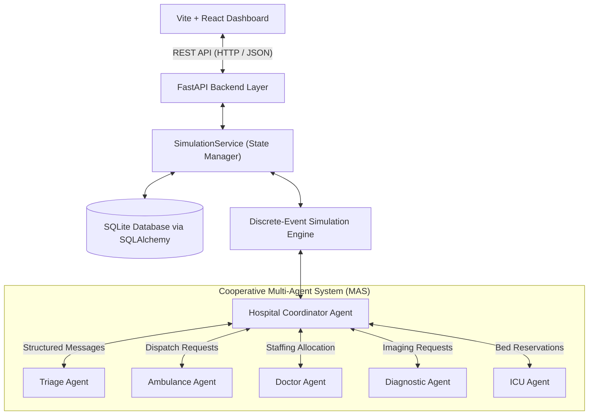
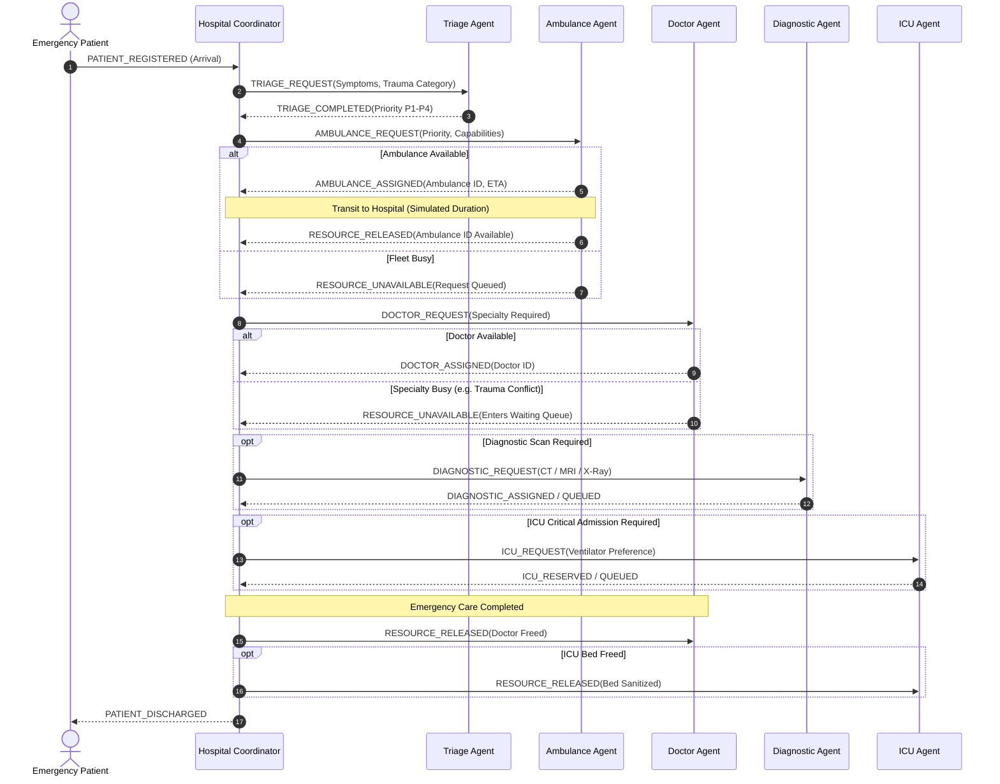
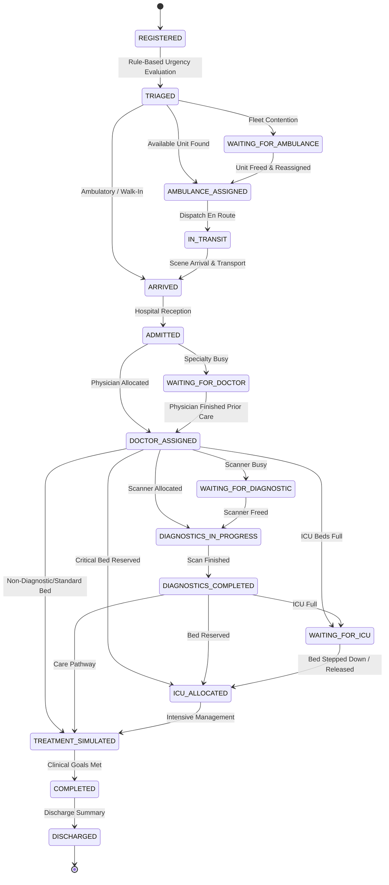

# System Architecture Specification
## Smart Hospital Emergency Response System Using Multi-Agent AI

### 1. High-Level System Architecture

The application is engineered as a cooperative, decentralized **Multi-Agent System (MAS)** where five specialized resource agents collaborate under a centralized **Hospital Coordinator** to optimize emergency patient throughput and manage scarce clinical resources.

---

### 2. Multi-Agent Communication Protocol

Agents communicate via typed structured messages complying with the protocol defined in Section 17:
- **Message Fields:** `message_id`, `sender`, `receiver`, `message_type`, `patient_id`, `resource_id`, `simulation_time`, `correlation_id`, `payload`, `status`.
- **Communication Pattern:** Event-driven message dispatching mediated by the Hospital Coordinator.

---

### 3. Patient Workflow State Machine (FSM)

The workflow advances through strict validated state transitions:

---

### 4. Mathematical Decision & Ranking Models

#### A. Ambulance Selection Score
Eligible ambulances ($S_{status} = \text{AVAILABLE}$) are scored as:
$$\text{Score}_{\text{amb}} = 100 - (\text{Distance}_{\text{km}} \times 5.0) + \mathbf{1}_{\{P = \text{P1} \land \text{Ventilator} \in \text{Caps}\}} \times 20.0$$
*Candidate with the maximum score is chosen; ties broken deterministically by Ambulance ID.*

#### B. Doctor Staffing Score
Eligible physicians with specialty matching patient requirement:
$$\text{Score}_{\text{doc}} = 100.0 - (\text{WorkloadCount} \times 10.0)$$
*Physician with the lowest prior workload is selected to balance clinical burn-out.*

#### C. Waiting Queue Priority Comparison (Section 28)
- **FIFO Strategy:** Orders waiting candidates strictly by arrival timestamp:
  $$\text{Key}_{\text{FIFO}} = t_{\text{arrival}}$$
- **Priority-Aware Strategy:** Orders critical life-threats first:
  $$\text{Key}_{\text{Priority}} = (\text{PriorityWeight}(P), t_{\text{arrival}})$$
  where $\text{PriorityWeight}(\text{P1})=1, \text{P2}=2, \text{P3}=3, \text{P4}=4$.

---

### 5. Database Schema & Entities

The relational database is persisted in SQLite using SQLAlchemy ORM:
- **`patients`**: Tracks demographic data, assigned resources, priority, workflow state, and exact simulation milestone timestamps.
- **`ambulances`**: Call sign, status, base distance, equipment capabilities, and total busy time.
- **`doctors`**: Physician name, medical specialty, status, current assignment, workload count, and total busy time.
- **`diagnostic_resources`**: Scanner category (CT, MRI, X-Ray, Lab, Ultrasound), status, queue length, simulated duration.
- **`icu_beds`**: Unit name, status, ventilator capability, reservation/release timestamps.
- **`simulation_events`**: Chronological event logs with conflict flags and outcomes.
- **`agent_messages`**: Outbox/inbox structured communication logs with correlation IDs.
- **`simulation_runs`**: Historical run records, execution metrics JSON, and comparison data.
