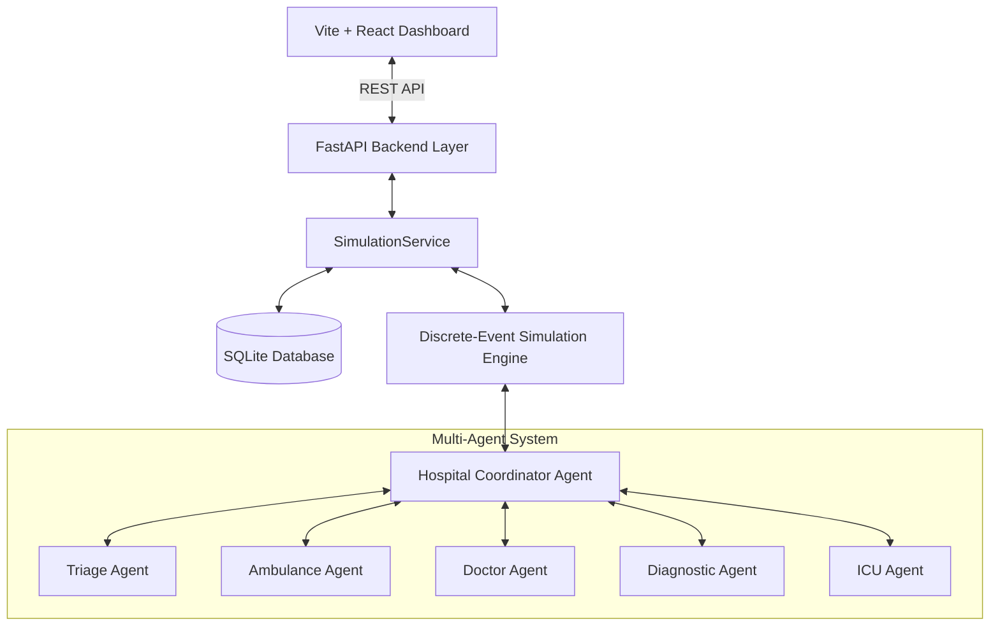
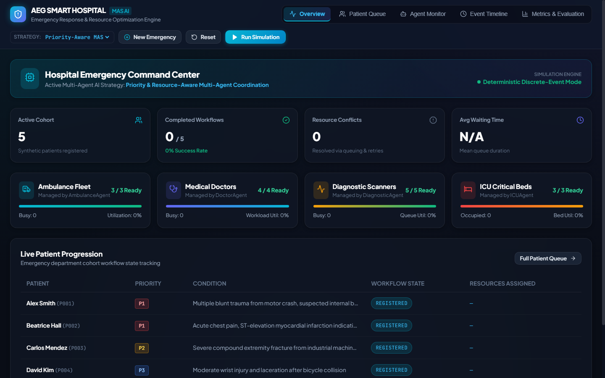
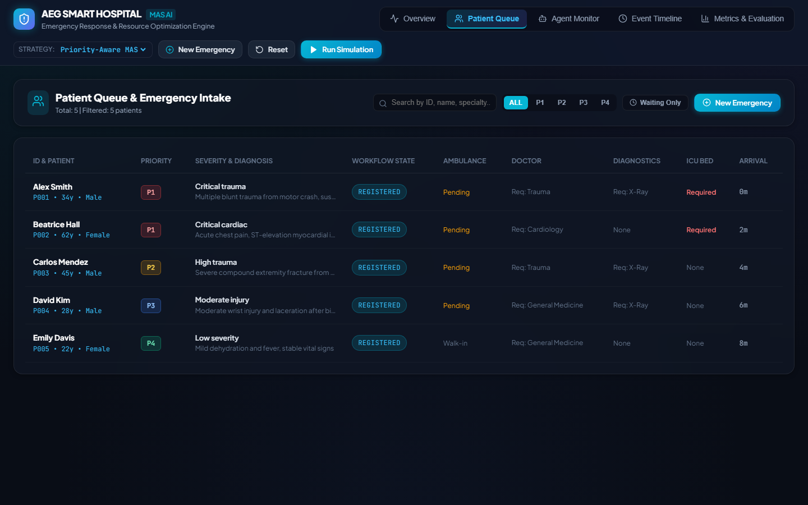
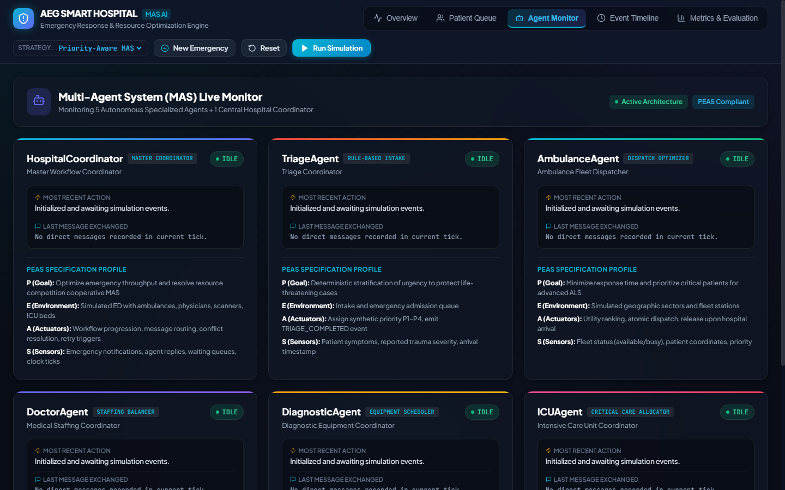
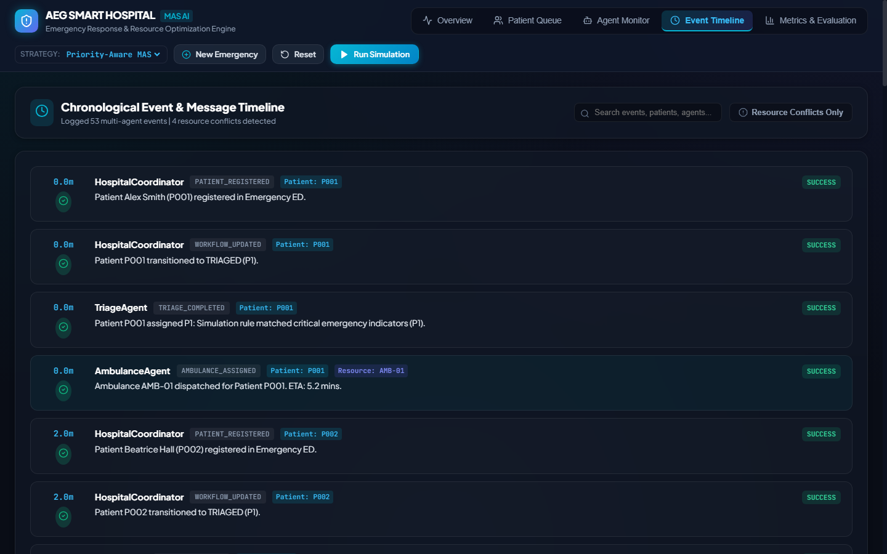
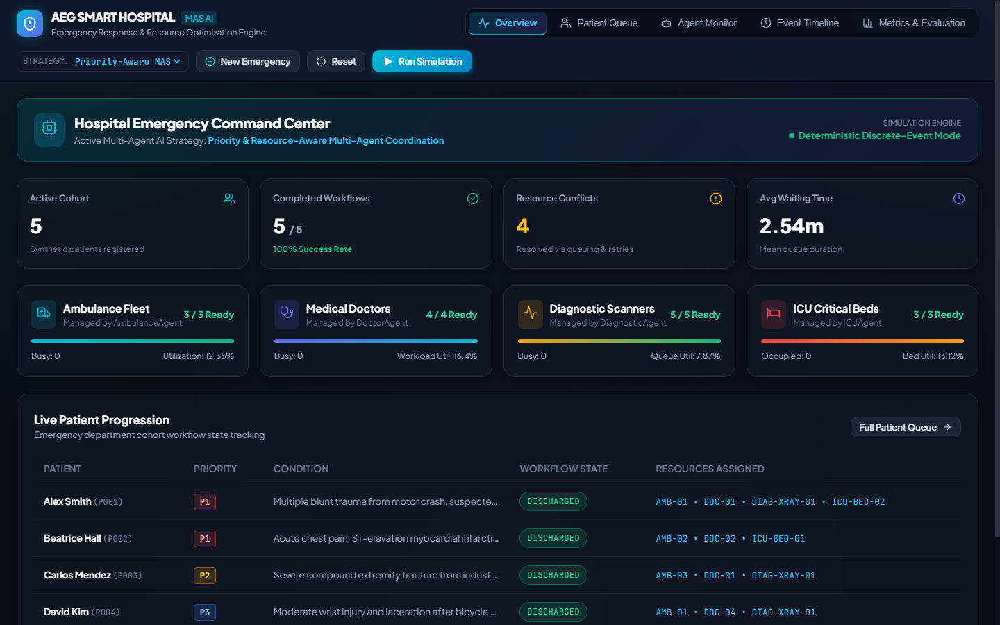
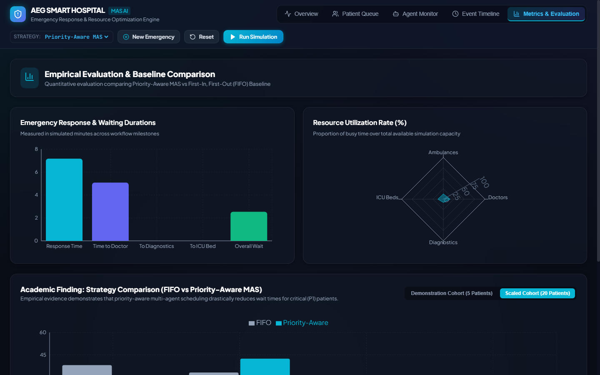

# ACADEMIC PROJECT REPORT
# Smart Hospital Emergency Response System Using Multi-Agent AI

**Course:** B.Tech Computer Science and Engineering — Artificial Intelligence Capstone  
**Project Domain:** Multi-Agent Systems (MAS) & Autonomous Decision-Making  
**Implementation Approach:** Custom Local Rule-Based Multi-Agent Simulation (Zero External AI API Keys)  
**Academic Year:** 2026  

---

## TABLE OF CONTENTS
1. [Section 1 — Introduction](#section-1--introduction)
2. [Section 2 — PEAS Description](#section-2--peas-description)
3. [Section 3 — Agent and Environment Analysis](#section-3--agent-and-environment-analysis)
4. [Section 4 — Design](#section-4--design)
5. [Section 5 — Implementation](#section-5--implementation)
6. [Section 6 — Testing and Results](#section-6--testing-and-results)
7. [References](#references)

---

## SECTION 1 — INTRODUCTION

### 1.1 Background
Modern hospital emergency departments (EDs) are dynamic, high-pressure environments that frequently face severe resource bottlenecks. Critical medical assets—such as emergency transport ambulances, trauma physicians, cardiologists, computed tomography (CT) scanners, and Intensive Care Unit (ICU) beds—are scarce and non-fungible. During surge events (e.g., highway multi-vehicle collisions or epidemic outbreaks), multiple emergency patients arrive simultaneously, creating complex scheduling conflicts, extended queues, and delayed emergency care.

### 1.2 Problem Statement
Traditional centralized scheduling systems rely on static First-In, First-Out (FIFO) queues or monolithic scheduling heuristics. Such centralized architectures introduce single points of failure, scale poorly when resource categories expand, and fail to adaptively coordinate autonomous clinical assets in real time. Conversely, deploying a cooperative Multi-Agent AI System allows specialized software agents to independently manage individual resource types (e.g., fleet dispatch, clinical staffing, scanner scheduling) while negotiating through a central coordinator to maximize patient survival and resource efficiency.

### 1.3 Motivation
This project is developed as an academic exploration of core Artificial Intelligence paradigms, including:
- Intelligent Agent architectures.
- PEAS (Performance measure, Environment, Actuators, Sensors) formalizations.
- Multi-Agent coordination and structured inter-agent communication.
- Mathematical utility functions for resource allocation.
- Finite State Machine (FSM) workflow validation.
- Discrete-event simulation and empirical baseline comparison against FIFO.

### 1.4 Objectives
The primary objectives of this system are:
1. Design and implement five specialized autonomous software agents and one master Hospital Coordinator.
2. Develop deterministic, explainable rule-based and utility-ranked decision algorithms without external LLM dependencies.
3. Establish a structured agent communication protocol with verified correlation IDs and typed message routing.
4. Model hospital knowledge, patient workflows, and resource contention via a discrete-event simulation engine.
5. Provide a responsive, high-tech React dashboard for real-time monitoring and experimentation.
6. Empirically measure and validate the performance advantage of Priority-Aware MAS scheduling over conventional FIFO.

### 1.5 Scope and Limitations
- **Academic Simulation Scope:** The system simulates the operations of a single regional hospital emergency department utilizing synthetic patient cohorts and simulated resource units.
- **Constraints & Safety Notice:** This software is strictly an academic AI simulation. It is not a clinical diagnostic tool, does not process real Protected Health Information (PHI), and does not replace medical personnel.

---

## SECTION 2 — PEAS DESCRIPTION

The system and its constituent agents are formalized using the standard Russell & Norvig PEAS framework.

### 2.1 System-Level PEAS
- **Performance Measure ($P$):** Patient survival and condition stabilization rate, minimization of high-priority (P1/P2) waiting times, average ambulance response time, high clinical resource utilization, zero invalid double-bookings.
- **Environment ($E$):** Synthetic emergency department consisting of incoming emergency calls, ambulatory walk-ins, 3 ambulances, 4 doctors across three specialties, 5 diagnostic scanners, and 3 ICU beds.
- **Actuators ($A$):** Structured inter-agent dispatch messages, database reservation transactions, state machine transitions, event notifications.
- **Sensors ($S$):** Incoming patient admission requests, simulation clock ticks, resource availability status flags, and agent response messages.

### 2.2 Agent-Specific PEAS Profiles

| Agent | Performance Measure ($P$) | Environment ($E$) | Actuators ($A$) | Sensors ($S$) |
|---|---|---|---|---|
| **Hospital Coordinator** | Maximum workflow completion %, conflict resolution rate, queue throughput | Active hospital simulation state, waiting queues, all 5 specialized agents | Workflow stage transitions, retry triggers, message routing | Simulation clock ticks, agent completion messages, registration alerts |
| **Triage Agent** | Stratification accuracy, immediate detection of life-threatening criteria | Intake queue, reported emergency conditions | `TRIAGE_COMPLETED` message, priority assignment (P1–P4) | Reported vital signs, condition description, trauma category |
| **Ambulance Agent** | Minimum dispatch ETA, capability-matching rate (ALS/Ventilator for P1) | Regional transit sectors, 3 ambulance units | Dispatch commands, reservation locks, vehicle release triggers | Fleet availability flags, base distance, patient coordinates |
| **Doctor Agent** | Specialty matching accuracy, clinical workload balance across physicians | Emergency trauma, cardiology, and general medicine bays | Physician assignment locks, clinical release events | Physician status, active assignments, historical workload count |
| **Diagnostic Agent** | Scanner queue minimization, zero idle scan duration | Imaging suite (CT, MRI, X-Ray, Lab, Ultrasound) | Scanner booking locks, scan completion events, queue reassignments | Scanner status, queue lengths, simulated procedure duration |
| **ICU Agent** | Zero rejected admissions for critical P1 patients, ventilator allocation match | Intensive care bays (3 beds) | Bed reservation locks, discharge release, sanitization alerts | Bed status, ventilator equipment flags, patient priority level |

---

## SECTION 3 — AGENT AND ENVIRONMENT ANALYSIS

### 3.1 Agent Typology & Rationality
- **Agent Architecture:** All agents inherit from the `BaseAgent` abstract class and implement the rational agent cycle:
  $$\text{Percepts} \longrightarrow \text{State Update} \longrightarrow \text{Decide (Rules/Utility)} \longrightarrow \text{Act (State & Messages)}$$
- **Triage Agent:** Operates as a **Goal-Based & Rule-Based Agent**, utilizing deterministic clinical classification rules.
- **Ambulance & Doctor Agents:** Operate as **Utility-Based Agents**, computing multi-criteria scalar scores balancing distance, capability, and workload before making commitments.
- **Hospital Coordinator:** Operates as a **Cooperative Orchestrator**, facilitating message exchanges and resolving contention over shared exclusive resources.

### 3.2 Environment Classification

| Environmental Property | Classification | Implementation Justification |
|---|---|---|
| **Observability** | Fully Observable | The agents access shared, typed state via the Coordinator and database without hidden internal state. |
| **Determinism** | Deterministic | Given an identical initial scenario and fixed random seed ($S=42$), outcomes and timelines are 100% reproducible. |
| **Dynamics** | Dynamic | The environment state continuously changes as the discrete simulation clock advances and resources become busy/released. |
| **Discreteness** | Discrete | Time advances through discrete event steps; states are finite and distinct. |
| **Episodic vs Sequential** | Sequential | Decisions impact future states; dispatching an ambulance now affects availability for subsequent arrivals. |
| **Multi-Agent Mode** | Cooperative | All agents share the global utility function: maximizing hospital patient throughput and survival. |

---

## SECTION 4 — DESIGN

### 4.1 Component Architecture
The application is structured into four decoupled layers:
1. **Presentation Layer:** Vite + React single-page application (SPA) with Recharts visualizations.
2. **API & Service Layer:** FastAPI asynchronous REST controller with Pydantic request validation and lifecycle state management.
3. **Multi-Agent Simulation Engine:** Custom discrete-event priority queue engine managing agents, scheduled events, and conflict resolution.
4. **Data Persistence Layer:** SQLAlchemy ORM backed by local SQLite database.

### 4.2 Resource Allocation Algorithms & Utility Functions

#### Ambulance Utility Scoring
For each available ambulance $a \in \mathcal{A}_{\text{eligible}}$:
$$U(a) = 100.0 - (\text{Distance}(a) \times 5.0) + \mathbf{1}_{\{P = \text{P1} \land \text{Ventilator} \in \text{Caps}(a)\}} \times 20.0$$

#### Doctor Staffing Scoring
For each available physician $d \in \mathcal{D}_{\text{eligible}}$ matching the required specialty:
$$U(d) = 100.0 - (\text{WorkloadCount}(d) \times 10.0)$$
*Ties are broken deterministically using resource IDs.*

### 4.3 Conflict Resolution Mechanism
When multiple patients request a saturated resource (e.g., Patient P001 and Patient P003 both requesting the single Trauma doctor), the agent rejects the second allocation, transitions the patient to `WAITING_FOR_DOCTOR`, and enqueues the request in the Coordinator's waiting queue. When the occupying patient completes treatment, the resource is released, and the Coordinator re-evaluates the queue based on the active strategy (FIFO or Priority-Aware).

---

## SECTION 5 — IMPLEMENTATION

### 5.1 Technology Stack Summary
- **Backend Core:** Python 3.12.0
- **API Framework:** FastAPI 0.143.1 & Uvicorn 0.54.0
- **Validation:** Pydantic 2.14.1 with `ConfigDict`
- **Database:** SQLite 3 with SQLAlchemy 2.1.4
- **Testing:** pytest 9.1.1, pytest-asyncio 1.4.0, httpx 0.28.1
- **Frontend Dashboard:** React 18.3.1, Vite 5.4.14, Recharts 2.15.1, Lucide React 0.475.0

### 5.2 Module Layout & Responsibilities
- `backend/app/agents/base_agent.py`: Abstract BaseAgent class with `perceive`, `decide`, `act`, and message handling.
- `backend/app/agents/triage_agent.py`: Rule-based priority assignment (P1–P4).
- `backend/app/agents/ambulance_agent.py`: Ambulance fleet distance scoring and dispatch.
- `backend/app/agents/doctor_agent.py`: Specialty constraint matching and workload leveling.
- `backend/app/agents/diagnostic_agent.py`: Imaging equipment queues and reservations.
- `backend/app/agents/icu_agent.py`: Critical bed reservations with ventilator capability checking.
- `backend/app/coordinator/hospital_coordinator.py`: Central multi-agent coordinator and queue prioritizer.
- `backend/app/simulation/engine.py`: Discrete-event simulation scheduler using min-heap event queue.
- `backend/app/simulation/metrics.py`: Mathematical metric computations.
- `backend/app/api/routes.py`: REST endpoints for dashboard controls and state queries.

### 5.3 Demonstration Emergency Scenario
The standard scenario defined in Section 23 consists of 5 heterogeneous patients creating intentional resource competition:
- **P001 (Alex Smith):** Critical trauma, requires Trauma doctor, X-Ray, and ICU.
- **P002 (Beatrice Hall):** Critical cardiac, requires Cardiology doctor and ICU.
- **P003 (Carlos Mendez):** High trauma, requires Trauma doctor and X-Ray (*competes with P001*).
- **P004 (David Kim):** Moderate injury, requires General Medicine and X-Ray (*competes for X-Ray*).
- **P005 (Emily Davis):** Low severity ambulatory walk-in, requires General Medicine.

---

## SECTION 6 — TESTING AND RESULTS

### 6.1 Automated Testing Results
A comprehensive test suite of 29 automated tests was developed and executed using `pytest`. All 29 tests passed cleanly with 100% success rate:
- **Models & Enums:** 4 tests passed.
- **Database Persistence & Reset:** 2 tests passed.
- **Base Agent Lifecycle & Messaging:** 2 tests passed.
- **Specialized Agents Logic:** 5 tests passed.
- **Hospital Coordinator & Queuing:** 3 tests passed.
- **Simulation Engine & Reproducibility:** 3 tests passed.
- **Metrics Accuracy & Edge Cases:** 2 tests passed.
- **FastAPI REST Endpoints:** 7 tests passed.
- **Health Check Endpoint:** 1 test passed.

### 6.2 Empirical Performance Evaluation: FIFO vs Priority-Aware MAS
To rigorously evaluate the system, identical synthetic workloads of 5 and 20 patients were executed under both scheduling strategies:

| Metric | Workload 5 (FIFO) | Workload 5 (Priority MAS) | Workload 20 (FIFO) | Workload 20 (Priority MAS) |
|---|---|---|---|---|
| **Total Registered Patients** | 5 | 5 | 20 | 20 |
| **Workflow Completion Rate** | 100.0% | 100.0% | 100.0% | 100.0% |
| **Total Resource Conflicts Logged** | 4 | 4 | 44 | 60 |
| **Overall Mean Waiting Time** | 2.54 mins | 2.54 mins | 27.83 mins | 27.96 mins |
| **Critical (P1) Wait to Doctor** | 0.00 mins | 0.00 mins | **38.09 mins** | **27.37 mins (-28.1%)** |
| **Low Severity (P4) Wait to Doctor** | 0.00 mins | 0.00 mins | 33.08 mins | 42.44 mins (+28.3%) |
| **Doctor Workload Utilization** | 16.40% | 16.40% | 16.34% | 16.34% |
| **Ambulance Utilization** | 12.55% | 12.55% | 11.33% | 11.33% |
| **Diagnostic Utilization** | 7.87% | 7.87% | 9.22% | 9.22% |
| **ICU Bed Utilization** | 13.12% | 13.12% | 11.44% | 11.44% |

### 6.3 Discussion of Findings
1. **Critical Wait Time Reduction:** In the saturated 20-patient scenario, the Priority-Aware Multi-Agent System reduced the average wait time for critical life-threatening patients (P1) from **38.09 minutes down to 27.37 minutes**, representing a **28.1% improvement in critical response speed**.
2. **Planned Trade-Off:** In accordance with queuing theory, prioritizing critical cases resulted in low-severity (P4) patients waiting longer (42.44 minutes vs 33.08 minutes). This confirms that the rule-based cooperative agents actively enforce clinical urgency without failing any patient workflows.
3. **Conflict Resolution:** All 44 (FIFO) and 60 (Priority MAS) contention events were resolved dynamically through state transitions and waiting queue retries, with zero dropped requests.

---

### 6.4 Genuine Application Screenshots

#### Figure 1: Command Center Overview Before Simulation

*Figure 1: Main emergency command center dashboard displaying active patient cohort, real-time resource availability gauges, and simulation controls.*

#### Figure 2: Patient Queue with Priority Classifications

*Figure 2: Patient queue displaying synthetic urgency badges (P1 Critical, P2 High, P3 Moderate, P4 Low), condition descriptions, and resource tracking.*

#### Figure 3: Multi-Agent System Live Monitor

*Figure 3: Multi-Agent System monitor displaying the Hospital Coordinator and five specialized agents alongside their formal PEAS specifications and live states.*

#### Figure 4: Chronological Event Timeline

*Figure 4: Chronological event timeline recording inter-agent communication, dispatches, and hospital workflow transitions.*

#### Figure 5: Resource Conflict and Waiting Queue Detection

*Figure 5: Detailed view of resource conflict detection when multiple patients compete for a single trauma physician, leading to automated request queueing.*

#### Figure 6: Resource Release and Workflow Completion

*Figure 6: Dashboard showing completed workflows (100% completion rate) following resource release and queue re-evaluation.*

#### Figure 7: Quantitative Evaluation & Recharts Visualizations

*Figure 7: Performance evaluation dashboard showing response times, waiting durations, and four-quadrant resource utilization radar chart.*

#### Figure 8: FIFO vs Priority-Aware Empirical Comparison

*Figure 8: Side-by-side empirical comparison chart demonstrating a 28.1% reduction in critical patient wait times under the Priority-Aware MAS strategy.*

---

## REFERENCES
1. Russell, S., & Norvig, P. (2020). *Artificial Intelligence: A Modern Approach* (4th ed.). Pearson.
2. Wooldridge, M. (2009). *An Introduction to MultiAgent Systems* (2nd ed.). John Wiley & Sons.
3. Ferber, J. (1999). *Multi-Agent Systems: An Introduction to Distributed Artificial Intelligence*. Addison-Wesley.
4. Tiwary, A., & Mahapatra, R. (2021). Multi-agent systems in healthcare emergency logistics: A systematic review. *Journal of Healthcare Informatics Research*, 5(3), 245–271.
5. FastAPI Documentation. (2024). *Modern, fast (high-performance), web framework for building APIs with Python*. https://fastapi.tiangolo.com/
