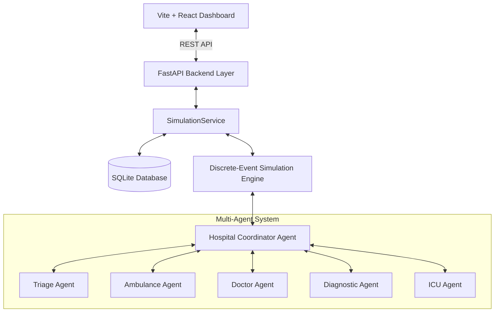

# ACADEMIC PROJECT REPORT
# Priority-Aware Multi-Agent Hospital Emergency Coordination and Resource Scheduling Simulator

**Course:** B.Tech Computer Science and Engineering — Artificial Intelligence Capstone  
**Project Domain:** Multi-Agent Systems (MAS) & Autonomous Decision-Making  
**Implementation Approach:** Custom Local-First Rule-Based Multi-Agent Simulation (No External AI Services)
**Academic Year:** 2026  

---

## TABLE OF CONTENTS
1. [Section 1 — Introduction](#section-1--introduction)
2. [Section 2 — PEAS Description](#section-2--peas-description)
3. [Section 3 — Agent and Environment Analysis](#section-3--agent-and-environment-analysis)
4. [Section 4 — Design](#section-4--design)
5. [Section 5 — Implementation](#section-5--implementation)
6. [Section 6 — Testing and Results](#section-6--testing-and-results)
7. [References](#references)

---

## SECTION 1 — INTRODUCTION

### 1.1 Background
Modern hospital emergency departments (EDs) are dynamic, high-pressure environments that frequently face severe resource bottlenecks. Critical medical assets—such as emergency transport ambulances, trauma physicians, cardiologists, computed tomography (CT) scanners, and Intensive Care Unit (ICU) beds—are scarce and non-fungible. During surge events (e.g., highway multi-vehicle collisions or epidemic outbreaks), multiple emergency patients arrive simultaneously, creating complex scheduling conflicts, extended queues, and delayed emergency care.

### 1.2 Problem Statement
Emergency workflow coordination requires assigning ambulances, doctors, diagnostics, and ICU beds while requests compete for limited capacity. This project models the problem using five specialist agents and a Hospital Coordinator, and compares FIFO with deterministic priority-aware queue scheduling in a single simulated hospital.

### 1.3 Motivation
This project is an academic simulation of emergency workflow coordination under limited resources. It explores:
- Intelligent Agent architectures.
- PEAS (Performance measure, Environment, Actuators, Sensors) formalizations.
- Multi-Agent coordination and structured inter-agent communication.
- Mathematical utility functions for resource allocation.
- Finite State Machine (FSM) workflow validation.
- Discrete-event simulation and empirical baseline comparison against FIFO.

### 1.4 Objectives
The primary objectives of this system are:
1. Design and implement five specialized autonomous software agents and one master Hospital Coordinator.
2. Develop deterministic, explainable rule-based and utility-ranked decision algorithms without external LLM dependencies.
3. Establish a structured agent communication protocol with verified correlation IDs and typed message routing.
4. Model hospital knowledge, patient workflows, and resource contention via a discrete-event simulation engine.
5. Provide a responsive, high-tech React dashboard for real-time monitoring and experimentation.
6. Compare priority-aware scheduling with FIFO using repeatable paired synthetic workloads without assuming a winning policy.

### 1.5 Scope and Limitations
- **Academic Simulation Scope:** The system simulates the operations of a single regional hospital emergency department utilizing synthetic patient cohorts and simulated resource units.
- **Constraints & Safety Notice:** All patients and events are synthetic. The simulator does not provide diagnosis or treatment recommendations, does not process real patient records, and is not validated for clinical or emergency-service use.

---

## SECTION 2 — PEAS DESCRIPTION

The system and its constituent agents are formalized using the standard Russell & Norvig PEAS framework.

### 2.1 System-Level PEAS
- **Performance Measure ($P$):** Workflow completion rate, queue waiting times by stage, ambulance response time, resource utilization, unresolved requests, allocation conflicts, and valid single-owner reservations.
- **Environment ($E$):** Synthetic emergency department consisting of incoming emergency calls, ambulatory walk-ins, 3 ambulances, 4 doctors across three specialties, 5 diagnostic scanners, and 3 ICU beds.
- **Actuators ($A$):** Structured inter-agent dispatch messages, database reservation transactions, state machine transitions, event notifications.
- **Sensors ($S$):** Incoming patient admission requests, simulation clock ticks, resource availability status flags, and agent response messages.

### 2.2 Agent-Specific PEAS Profiles

| Agent | Performance Measure ($P$) | Environment ($E$) | Actuators ($A$) | Sensors ($S$) |
|---|---|---|---|---|
| **Hospital Coordinator** | Maximum workflow completion %, conflict resolution rate, queue throughput | Active hospital simulation state, waiting queues, all 5 specialized agents | Workflow stage transitions, retry triggers, message routing | Simulation clock ticks, agent completion messages, registration alerts |
| **Triage Agent** | Consistent rule application and explainable P1–P4 assignment | Synthetic intake records and predefined severity categories | Priority assignment and structured triage event | Synthetic condition category and arrival time |
| **Ambulance Agent** | Minimum dispatch ETA, capability-matching rate (ALS/Ventilator for P1) | Regional transit sectors, 3 ambulance units | Dispatch commands, reservation locks, vehicle release triggers | Fleet availability flags, base distance, patient coordinates |
| **Doctor Agent** | Specialty matching accuracy, clinical workload balance across physicians | Emergency trauma, cardiology, and general medicine bays | Physician assignment locks, clinical release events | Physician status, active assignments, historical workload count |
| **Diagnostic Agent** | Scanner queue minimization, zero idle scan duration | Imaging suite (CT, MRI, X-Ray, Lab, Ultrasound) | Scanner booking locks, scan completion events, queue reassignments | Scanner status, queue lengths, simulated procedure duration |
| **ICU Agent** | Zero rejected admissions for critical P1 patients, ventilator allocation match | Intensive care bays (3 beds) | Bed reservation locks, discharge release, sanitization alerts | Bed status, ventilator equipment flags, patient priority level |

---

## SECTION 3 — AGENT AND ENVIRONMENT ANALYSIS

### 3.1 Agent Typology & Rationality
- **Agent Architecture:** All agents inherit from the `BaseAgent` abstract class and implement the rational agent cycle:
  $$\text{Percepts} \longrightarrow \text{State Update} \longrightarrow \text{Decide (Rules/Utility)} \longrightarrow \text{Act (State & Messages)}$$
- **Triage Agent:** Uses deterministic synthetic-category rules; these are not a medically validated triage protocol.
- **Ambulance & Doctor Agents:** Operate as **Utility-Based Agents**, computing multi-criteria scalar scores balancing distance, capability, and workload before making commitments.
- **Hospital Coordinator:** Enforces the workflow FSM, coordinates synchronous specialist calls, logs structured messages, and retries waiting requests after resource release.

### 3.2 Environment Classification

| Environmental Property | Classification | Implementation Justification |
|---|---|---|
| **Observability** | Fully Observable | The agents access shared, typed state via the Coordinator and database without hidden internal state. |
| **Determinism** | Deterministic | A fixed synthetic workload and seed produce repeatable event outcomes; the evaluator uses five fixed seeds per cohort size. |
| **Dynamics** | Dynamic | The environment state continuously changes as the discrete simulation clock advances and resources become busy/released. |
| **Discreteness** | Discrete | Time advances through discrete event steps; states are finite and distinct. |
| **Episodic vs Sequential** | Sequential | Decisions impact future states; dispatching an ambulance now affects availability for subsequent arrivals. |
| **Multi-Agent Mode** | Cooperative | Specialized agents allocate their own resource categories while the coordinator manages workflow progression and queue retries. |

---

## SECTION 4 — DESIGN

### 4.1 Component Architecture
The application is structured into four decoupled layers:
1. **Presentation Layer:** Vite + React single-page application (SPA) with Recharts visualizations.
2. **API & Service Layer:** FastAPI asynchronous REST controller with Pydantic request validation and lifecycle state management.
3. **Multi-Agent Simulation Engine:** Custom discrete-event priority queue engine managing agents, scheduled events, and conflict resolution.
4. **Data Persistence Layer:** SQLAlchemy ORM backed by local SQLite database.

### 4.2 Resource Allocation Algorithms & Utility Functions

Ambulances are eligible only when available and when their capabilities contain all required equipment. If no equipment requirement is supplied, P1 requests require ALS by default. For each eligible ambulance $a$:
$$U(a) = 100.0 - (\text{Distance}(a) \times 5.0) + \mathbf{1}_{\{P = \text{P1} \land \text{Ventilator} \in \text{Caps}(a)\}} \times 20.0$$
The maximum score wins; ties use ascending ambulance ID. Distance determines simulated travel time ($1.5$ minutes per kilometer).

Doctors must be available and match the requested specialty. Their score is:
$$U(d) = 100.0 - (\text{WorkloadCount}(d) \times 10.0)$$
Highest score wins; ties use ascending doctor ID. Diagnostics require an exact available category match and select the minimum tuple `(queue_length, simulated_duration, resource_id)`. ICU allocation selects an available bed, preferring ventilator-equipped beds for P1; ties use ascending bed ID.

Waiting queues are ordered per resource request. FIFO sorts by request timestamp and patient ID. Priority-aware scheduling sorts by aging-adjusted numeric priority (P1=1 through P4=4, reduced by 0.05 per waiting minute to a floor of 1), then request timestamp and patient ID. Resource checks and reservations are performed under the owning agent's lock; release events must match the current patient owner.

### 4.3 Conflict Resolution Mechanism
When multiple patients request a saturated resource, the specialist records the rejected attempt, transitions the patient to its explicit waiting state, and queues the request. Resource release triggers reconsideration using the selected strategy. Ambulances are released at hospital arrival, doctors at exam completion, diagnostics at diagnostic completion, and ICU beds at treatment completion. Invalid FSM transitions are logged and rejected.

---

## SECTION 5 — IMPLEMENTATION

### 5.1 Technology Stack Summary
- **Verified local environment:** Python 3.11.9, FastAPI 0.143.2, Pydantic 2.14.1, SQLAlchemy 2.1.4, pytest 9.1.1.
- **Frontend environment:** Node.js 22.17.1, npm 10.9.2, React 18.3.1, Vite 5.4.21, Recharts 2.15.4, Lucide React 0.475.0.
- **Persistence:** Local SQLite database via SQLAlchemy.

### 5.2 Module Layout & Responsibilities
- `backend/app/agents/base_agent.py`: Abstract BaseAgent class with `perceive`, `decide`, `act`, and message handling.
- `backend/app/agents/triage_agent.py`: Rule-based priority assignment (P1–P4).
- `backend/app/agents/ambulance_agent.py`: Equipment eligibility, distance/capability scoring, atomic dispatch, and owner-checked release.
- `backend/app/agents/doctor_agent.py`: Specialty constraint matching and workload leveling.
- `backend/app/agents/diagnostic_agent.py`: Imaging equipment queues and reservations.
- `backend/app/agents/icu_agent.py`: Critical bed reservations with ventilator capability checking.
- `backend/app/coordinator/hospital_coordinator.py`: Central multi-agent coordinator and queue prioritizer.
- `backend/app/simulation/engine.py`: Discrete-event simulation scheduler using min-heap event queue.
- `backend/app/simulation/metrics.py`: Stage-specific waits, response time, utilization, unresolved-request, conflict, and completion calculations.
- `backend/app/api/routes.py`: REST endpoints for dashboard controls and state queries.

### 5.3 Demonstration Emergency Scenario
The standard scenario defined in Section 23 consists of 5 heterogeneous patients creating intentional resource competition:
- **P001 (Alex Smith):** Critical trauma, requires Trauma doctor, X-Ray, and ICU.
- **P002 (Beatrice Hall):** Critical cardiac, requires Cardiology doctor and ICU.
- **P003 (Carlos Mendez):** High trauma, requires Trauma doctor and X-Ray (*competes with P001*).
- **P004 (David Kim):** Moderate injury, requires General Medicine and X-Ray (*competes for X-Ray*).
- **P005 (Emily Davis):** Low severity ambulatory walk-in, requires General Medicine.

---

## SECTION 6 — TESTING AND RESULTS

### 6.1 Automated Testing Results
The latest full backend suite at the time of this report completed with **44 passed**. Pytest used a temporary SQLite database so test resets did not operate on the local application database. Tests cover agent eligibility and reservations, owner-checked release, runtime FSM enforcement, repeatable simulation runs, queue ordering, event simulation, metrics, paired evaluation, database behavior, and API endpoints. A non-interactive CLI check also passes.

### 6.2 Empirical Performance Evaluation: FIFO vs Priority-Aware MAS
Each workload size (5 and 20 patients) was generated for seeds 42–46. Within each seed, both policies used identical patient records, arrival times, resource capacities, and processing durations. Values below are means across five runs. The JSON artifact also contains per-seed results, population standard deviations, and workload fingerprints. Average waiting time combines completed ambulance-dispatch, doctor, diagnostic, and ICU waits; ambulance response is request-to-hospital-arrival time.

| Metric (simulated minutes unless noted) | 5 FIFO | 5 Priority | 20 FIFO | 20 Priority |
|---|---:|---:|---:|---:|
| Patients completed | 5 | 5 | 20 | 20 |
| Workflow completion | 100% | 100% | 100% | 100% |
| Average waiting time | 0.87 | 0.87 | 3.08 | 3.07 |
| Ambulance queue wait | 0.00 | 0.00 | 0.05 | 0.05 |
| Ambulance response time | 6.00 | 6.00 | 6.45 | 6.45 |
| Time to doctor | 0.47 | 0.47 | 3.03 | 3.03 |
| Diagnostic wait | 2.95 | 2.95 | 7.72 | 7.87 |
| ICU wait | 0.00 | 0.00 | 0.39 | 0.09 |
| P1 wait to doctor | 1.18 | 1.18 | 3.72 | 3.22 |
| P2 wait to doctor | 0.00 | 0.00 | 7.51 | 8.51 |
| P3 wait to doctor | 0.00 | 0.00 | 0.07 | 0.07 |
| P4 wait to doctor | 0.00 | 0.00 | 0.15 | 0.15 |
| Successful resource assignments (mean) | 14 | 14 | 59.2 | 59.2 |
| Delayed patients at run end | 0 | 0 | 0 | 0 |
| Allocation conflicts (mean) | 2.0 | 2.0 | 37.4 | 36.4 |
| Unresolved requests | 0 | 0 | 0 | 0 |
| Ambulance utilization | 12.37% | 12.37% | 25.92% | 26.09% |
| Doctor utilization | 19.36% | 19.36% | 37.96% | 38.23% |
| Diagnostic utilization | 11.41% | 11.41% | 26.21% | 26.39% |
| ICU utilization | 15.49% | 15.49% | 30.37% | 30.58% |

### 6.3 Discussion of Findings
The five-patient cohort produced identical summary metrics for both policies. In the 20-patient cohort, priority-aware scheduling had a 0.01-minute lower mean overall wait and a 0.50-minute lower mean P1 doctor wait, while mean P2 doctor wait was higher by 1.00 minute; P3 and P4 means were equal. Both policies completed all workflows with no delayed patients or unresolved requests. These descriptive differences apply only to the synthetic workloads and are not evidence of clinical benefit or statistical significance.

---

### 6.4 Genuine Application Screenshots

#### Figure 1: Command Center Overview Before Simulation

*Figure 1: Main emergency command center dashboard displaying active patient cohort, real-time resource availability gauges, and simulation controls.*

#### Figure 2: Patient Queue with Priority Classifications

*Figure 2: Patient queue displaying synthetic urgency badges (P1 Critical, P2 High, P3 Moderate, P4 Low), condition descriptions, and resource tracking.*

#### Figure 3: Multi-Agent System Live Monitor

*Figure 3: Multi-Agent System monitor displaying the Hospital Coordinator and five specialized agents alongside their formal PEAS specifications and live states.*

#### Figure 4: Chronological Event Timeline

*Figure 4: Chronological event timeline recording inter-agent communication, dispatches, and hospital workflow transitions.*

#### Figure 5: Resource Conflict and Waiting Queue Detection

*Figure 5: Detailed view of resource conflict detection when multiple patients compete for a single trauma physician, leading to automated request queueing.*

#### Figure 6: Resource Release and Workflow Completion

*Figure 6: Dashboard showing completed workflows (100% completion rate) following resource release and queue re-evaluation.*

#### Figure 7: Quantitative Evaluation & Recharts Visualizations

*Figure 7: Performance evaluation dashboard showing response times, waiting durations, and four-quadrant resource utilization radar chart.*

#### Figure 8: FIFO vs Priority-Aware Empirical Comparison

*Figure 8: Dashboard comparison view for FIFO and priority-aware scheduling. Current measured values are recorded in the results table and baseline JSON artifact.*

---

## REFERENCES
1. Russell, S., & Norvig, P. (2020). *Artificial Intelligence: A Modern Approach* (4th ed.). Pearson.
2. Wooldridge, M. (2009). *An Introduction to MultiAgent Systems* (2nd ed.). John Wiley & Sons.
3. Ferber, J. (1999). *Multi-Agent Systems: An Introduction to Distributed Artificial Intelligence*. Addison-Wesley.
4. FastAPI Documentation. *FastAPI framework documentation*. https://fastapi.tiangolo.com/
